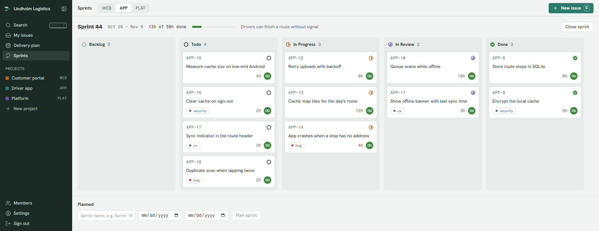
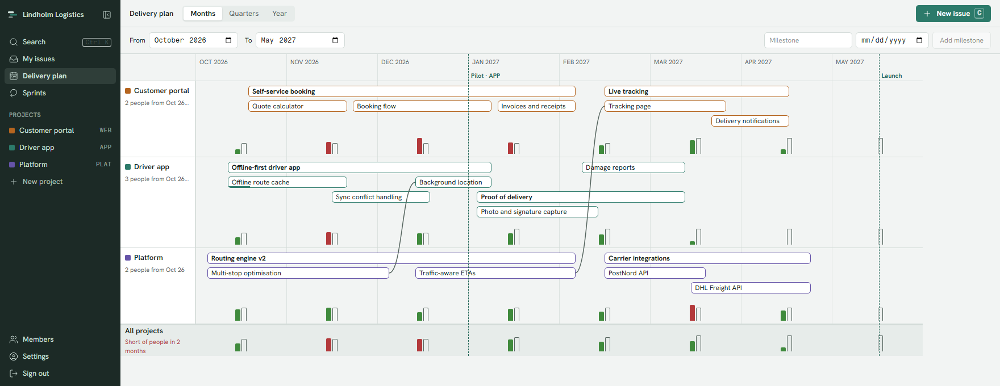

<p align="center">
  <picture>
    <source media="(prefers-color-scheme: dark)" srcset="docs/design/brand/kupro-mark-dark.svg">
    
  </picture>
</p>

<h1 align="center">Kupro</h1>

<p align="center">
  An issue tracker and delivery planner that agents can drive as well as people can.<br>
  Fast, simple, and built in Denmark on European infrastructure.
</p>

<p align="center">
  <a href="https://github.com/NielsPilgaard/Kupro/actions/workflows/ci.yml"></a>
</p>

<picture>
  <source media="(prefers-color-scheme: dark)" srcset="docs/images/board-dark.png">
  
</picture>

## Why Kupro

An alternative to Jira, Azure DevOps, Linear, Trello and Monday, for teams that want:

- **Agents as teammates.** Everything you can do in the UI, an agent can do through the REST API, the `kupro` CLI or
  MCP. A CI test fails when one of them falls behind.
- **Speed.** Every action answers in under 500 ms at p99, and the UI updates before the server replies.
- **Planning that works.** The delivery plan shows every project's epics and features over the year, the
  dependencies between them, and whether the people you have can deliver it.
- **A meeting agent** (in progress). Start it in standup; it listens and proposes the ticket changes it hears. You
  approve them, or let it apply them directly.
- **Simplicity.** One fixed workflow, effort in hours, no custom-field sprawl. Features are cut before they confuse.
- **Sovereignty.** Every vendor that touches your data is European ([vendor register](docs/adr/ADR-006-eu-vendor-policy.md#vendor-register)).
  English and Danish UI.

<picture>
  <source media="(prefers-color-scheme: dark)" srcset="docs/images/plan-dark.png">
  
</picture>

## Quickstart

Prerequisites: [.NET 10 SDK](https://dot.net), [Bun](https://bun.sh) 1.4, Docker.

```sh
dotnet tool restore   # installs the pinned Aspire CLI and dotnet-ef
dotnet aspire run     # starts Postgres, Keycloak, the API, the web app and the Aspire dashboard
```

Open the `web` URL from the dashboard (the terminal prints its address) and sign in as `dev@kupro.local` / `dev`.
Keycloak's emails, such as password resets, land in Mailpit at http://localhost:8125.

Keycloak imports the realm only into an empty `kupro-keycloak-data` volume. To pick up realm file changes, remove
that volume; the dev users keep their ids, so existing dev data stays linked.

Want something to look at? [`scripts/demo-seed.ps1`](scripts/demo-seed.ps1) creates the workspace from the
screenshots above through the CLI.

## Connect an agent

```sh
kupro login                                   # device flow in the browser; or: kupro token set kp_pat_...
kupro issue list --state todo                 # tables in a terminal, JSON when piped or with --json
claude mcp add kupro -- kupro mcp             # MCP over stdio with the CLI's credentials

# Remote MCP with an agent token (or omit --header to sign in with OAuth)
claude mcp add --transport http kupro http://localhost:5239/mcp --header "Authorization: Bearer kp_agent_..."
```

Any MCP client works; Claude Code is just the example. Parity between the UI, API, CLI and MCP is a project rule
([ADR-001](docs/adr/ADR-001-agent-parity.md)).

## Self-hosting

Kupro is AGPL-3.0, so you can run it yourself. The production stack is the generated
[deploy/docker-compose.yaml](deploy/docker-compose.yaml): Postgres with continuous backups, Keycloak, the API, the web
app and a Grafana-based observability stack. The [deploy runbook](docs/runbooks/deploy.md) describes how we run it on
a single VPS; adapt it to your setup. `dotnet aspire deploy` runs the same stack locally.

There are no releases, support or upgrade guarantees yet. The meeting agent and outgoing email need API keys from
their EU vendors ([ADR-015](docs/adr/ADR-015-meeting-agent-vendors.md)). A hosted version is planned.

## Repo layout

| Path | What |
|---|---|
| `src/Kupro.AppHost` | Aspire topology for local dev and the production compose file |
| `src/Kupro.Api` | REST API, MCP server, feature services, EF Core |
| `src/Kupro.Cli` | The `kupro` CLI |
| `web/` | React SPA (Bun, Vite); API client generated from `openapi/kupro.json` |
| `site/` | Public website (Astro) |
| `infrastructure/` | Keycloak theme, backup agent, observability config |
| `deploy/` | Generated by `aspire publish -o deploy`; don't edit by hand |
| `tests/` | xUnit + Testcontainers integration tests; Playwright end-to-end tests in `tests/e2e` |
| `docs/` | [Product](docs/product.md), [architecture decisions](docs/adr/INDEX.md), [design guide](docs/design-guide.md), runbooks |
| `tasks/` | Numbered task specs; build order in [tasks/INDEX.md](tasks/INDEX.md) |

## Contributing

Bug reports, ideas and pull requests are welcome. Read [CONTRIBUTING.md](CONTRIBUTING.md) first: it covers setup, the
project rules, the checks to run and the [CLA](CLA.md). Report security issues privately ([SECURITY.md](SECURITY.md)).
Everyone follows the [Code of Conduct](CODE_OF_CONDUCT.md).

## License

Copyright (C) 2026 Pilgaard Development.

Kupro is free software under the [GNU Affero General Public License v3.0](LICENSE). If you run a modified version as
a network service, you must offer its source code to the users of that service.
