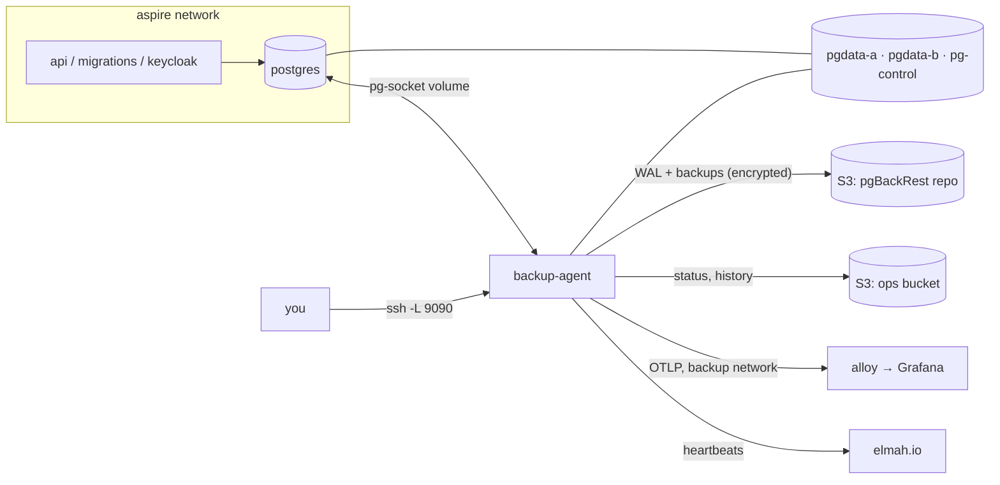

# Backup agent and break-glass console

A container that sits next to Postgres and owns everything backup-related: it streams WAL into a pgBackRest repo, takes
daily backups, restores a throwaway copy every week to prove the backups work, and serves a small web console for
restoring when things go wrong. The console runs on `127.0.0.1:9090` on the server, so you reach it over an SSH tunnel.
It needs nothing from the app (no Keycloak, no API, no app database), so it still works when all of those are down.

Ported from Skoleoverblikket's agent (same code, adapted: see [What differs from Skoleoverblikket](#what-differs-from-skoleoverblikket)).
The decision is [ADR-016](../../docs/adr/ADR-016-postgres-backups.md); the incident runbook is
[docs/runbooks/restore.md](../../docs/runbooks/restore.md); variables and first-time setup are in the
[deploy runbook](../../docs/runbooks/deploy.md).

## What you get

- **15-minute RPO.** WAL streams continuously over a replication slot. On quiet nights the agent forces a WAL switch
  every 5 minutes, so no more than about 15 minutes of data can be lost.
- **Point-in-time restore** to any minute in the last 35 days, to "just before migration X", or to a backup as it was.
- **A restore never touches live.** It goes into the other of two data volumes (A/B), gets checked, and only goes live
  when a person clicks **Go live** and restarts the stack. The old volume stays for forensics until you delete it.
- **Backups can't take Postgres down.** Postgres has no `archive_command`. If pgBackRest, S3 or the agent breaks, the
  result is a WAL gap and an alert, never a full disk.
- **Weekly drill.** Every Sunday the agent restores the newest backup into tmpfs, checks it against live, and throws it
  away. Restore time (RTO) is tracked per drill.
- **Alerts** two ways: OTLP metrics to Alloy, with Grafana rules for "unhealthy" and "silent" ([ADR-014](../../docs/adr/ADR-014-observability.md));
  and elmah.io heartbeats (WAL/overall health every 5 minutes, backup, verify, drill), which still fire when the VPS
  and Grafana are gone. An overdue quarterly manual drill also raises an alert.
- **History** of every run, action and checklist tick, in the console and in an S3 ops bucket. No row content is ever
  stored, only names and counts.

## Pinned versions

| Component | Version | Why it's pinned |
|---|---|---|
| Postgres | 18 (`postgres:18`) | A physical restore needs the same major on both sides. The agent image is built `FROM postgres:18` for `pg_receivewal`, `pg_ctl` and the throwaway restore server. Both Dockerfiles take `PG_MAJOR`; change them together. |
| pgBackRest | 2.59.x | Installed from the PGDG apt repo at build time (2.59.3 when tested). |
| .NET | 10 | Self-contained `linux-x64` publish, so the runtime ships in the image. |

## How it fits together

- The agent is **not** on the app network. It reaches Postgres only through the shared Unix socket, as the role
  `backup_agent` with peer authentication. Its own `backup` network has one other member, Alloy, for telemetry. Nothing
  reaches the console except `127.0.0.1:9090` on the host, plus a random access key in the agent's volume.
- **Two data volumes, one marker.** Both containers mount `kupro-pgdata-a` at `/pgdata/a` and `kupro-pgdata-b`
  at `/pgdata/b`, plus `kupro-pg-control` at `/pg-control`. Postgres's entrypoint
  ([select-volume.sh](../postgres/select-volume.sh)) reads `/pg-control/active` (`a` or `b`) and starts on that
  directory. The agent asks Postgres which directory it runs on (`data_directory`) and only ever writes to the other one.
- **Go live** writes the spare's letter to the marker. Restarting the stack starts Postgres on the restored volume, with
  the API and Keycloak fresh behind it. Switch back works the same way.
- The paths must be identical in both containers, because pgBackRest refuses a `pg1-path` that differs from the
  server's `data_directory`. The agent passes `--pg1-path` per call, since the live volume changes.

## Where things are

**[`infrastructure/postgres/`](../postgres/)**: the Postgres image, dev and prod. It has no backup tooling.

| File | What it does |
|---|---|
| [Dockerfile](../postgres/Dockerfile) | `postgres:18` plus our config, the init scripts and the volume-picking entrypoint |
| [select-volume.sh](../postgres/select-volume.sh) | Entrypoint. Sets `PGDATA` from `/pg-control/active`, refuses to `initdb` an empty volume once the marker exists, then runs the stock `docker-entrypoint.sh` |
| [postgresql.conf](../postgres/postgresql.conf) | `wal_level=replica`, slots, `max_slot_wal_keep_size=4GB`, `archive_mode=off`, `track_commit_timestamp=on`, memory for the 8 GB VPS |
| [pg_hba.conf](../postgres/pg_hba.conf), [pg_ident.conf](../postgres/pg_ident.conf) | Peer auth on the socket for `backup_agent` only (OS user `postgres`, uid 999, maps to it). Everyone else needs a password, on the socket too |
| [init/10-keycloak.sh](../postgres/init/10-keycloak.sh) | Keycloak's role and database (production only) |
| [init/20-backup-agent.sh](../postgres/init/20-backup-agent.sh) | The `backup_agent` role with its grants, and the `backup_agent_heartbeat` table in the `postgres` database |

**`infrastructure/backup-agent/`** (this folder): the agent.

| File | What it does |
|---|---|
| [Dockerfile](Dockerfile) | `postgres:18` + pgBackRest + the .NET agent, runs as uid 999. Build context: the repo root |
| [pgbackrest.conf](pgbackrest.conf) | S3 repo, AES-256 encryption, `repo1-retention-full=34` with daily fulls, `archive-check=n`. Secrets come from `PGBACKREST_*` env vars |
| [Program.cs](Program.cs) | Wiring, OpenTelemetry, security headers (CSP, antiforgery) |
| [AgentOptions.cs](AgentOptions.cs) | Every setting, bound from `Agent__*`, `OpsBucket__*` and `Heartbeats__*` env vars |
| [WalStreamer.cs](WalStreamer.cs) | Runs `pg_receivewal` into the `wal-receive` volume, pushes finished segments with `archive-push`, handles lost slots, new timelines and go-live detection |
| [Scheduler.cs](Scheduler.cs) | The tick: status every 5 minutes, then the due job (requested full, daily full, weekly verify, weekly drill). Mirrors migration times to the ops bucket |
| [BackupService.cs](BackupService.cs) | Backup, expire, verify and the drill |
| [RestoreService.cs](RestoreService.cs) | The restore wizard, go-live, cancel, switch back, delete old volume |
| [DrillChecks.cs](DrillChecks.cs) | The checks a drill and a restore run against the restored copy |
| [DataVolumes.cs](DataVolumes.cs) | Which volume is live and which is spare, and the marker file |
| [PgBackRest.cs](PgBackRest.cs) | The pgBackRest CLI wrapper, repo listing, restorable ranges |
| [Postgres.cs](Postgres.cs) | Live queries (as `backup_agent`) and the throwaway restore server |
| [Status.cs](Status.cs) | Health and issues. This is what the metrics, the WAL heartbeat and `status.json` carry |
| [AgentMetrics.cs](AgentMetrics.cs) | The status as OTLP gauges (`backup_agent_*`) for Grafana |
| [OpsBucket.cs](OpsBucket.cs) | `status.json`, `history/`, `migrations.json` in S3 |
| [Heartbeats.cs](Heartbeats.cs) | Heartbeats, one sender per vendor: elmah.io or ping URLs |
| [Pages/](Pages/) | The console: server-rendered HTML, no JavaScript framework |

**Elsewhere:**

- [Backups.cs](../../src/Kupro.AppHost/Backups.cs) in the AppHost runs Postgres and the agent under `aspire run`
  (Silo stands in for both buckets) and publishes them into [deploy/docker-compose.yaml](../../deploy/docker-compose.yaml).
- [scripts/backup-console.ps1](../../scripts/backup-console.ps1) opens the tunnel, reads the access link and opens the browser.
- [scripts/infra-image-tags.sh](../../scripts/infra-image-tags.sh) derives the Postgres and agent image tags from their
  sources; CI publishes an image only when its tag is new, and CD deploys those tags, so a normal deploy leaves the
  database container alone.
- `DatabaseExtensions.MigrateDatabaseAsync` (API) grants `backup_agent` `SELECT` on `__EFMigrationsHistory` after every migrate.
- Grafana's backup panels and alerts: [build_dashboards.py](../observability/build_dashboards.py).

## The contract

### Volumes

| Volume | Postgres | Agent | Holds |
|---|---|---|---|
| `kupro-pgdata-a`, `-b` | `/pgdata/a`, `/pgdata/b` | same paths | The database. One is live, the other is the restore target |
| `kupro-pg-control` | `/pg-control` | `/pg-control` | `active`: which one Postgres starts on |
| `kupro-pg-socket` | `/var/run/postgresql` | same | The socket. The agent's only way into Postgres |
| `kupro-wal-receive` | – | `/wal-receive` | WAL received but not yet in the repo. The only copy until it's pushed |
| `kupro-backup-agent-state` | – | `/var/lib/backup-agent` | `state.json`, the console key, local copies of the ops files |
| tmpfs | – | `/drill` | The weekly drill's restore. Must fit the whole cluster, and it counts against the agent's memory limit |

Every volume except `kupro-pg-socket` is **external** in compose: create them once per server (deploy runbook).
Never delete them, and never run `docker compose down -v`.

### Roles and authentication

- `backup_agent`: `LOGIN REPLICATION`, `pg_read_all_settings`, `pg_checkpoint`, and `EXECUTE` on the backup and WAL
  functions listed in [20-backup-agent.sh](../postgres/init/20-backup-agent.sh). It reads no table data. Row counts come
  from `pg_stat_user_tables`.
- It owns `backup_agent_heartbeat` in the `postgres` database. That's the only table it writes.
- The migrate step grants it `SELECT` on `__EFMigrationsHistory` (snake_case columns here: `migration_id`; the agent's
  query reads either spelling).
- `pg_hba.conf` must **not** allow `local all postgres peer`. The agent runs as uid 999, which is OS user `postgres` in
  the Postgres container, so peer auth for `postgres` would make the agent a superuser.

### Environment

Bound in [Program.cs](Program.cs) from the `Agent`, `OpsBucket` and `Heartbeats` sections ([AgentOptions.cs](AgentOptions.cs));
pgBackRest reads its own `PGBACKREST_*` variables, which the agent's child processes inherit. The AppHost maps the
Dokploy variables (deploy runbook) onto these.

| Variable | Default | Purpose |
|---|---|---|
| `PGBACKREST_REPO1_S3_ENDPOINT`, `_S3_REGION`, `_S3_BUCKET` | – | The repo bucket. Its own bucket, not shared with attachments or the ops bucket |
| `PGBACKREST_REPO1_S3_KEY`, `_S3_KEY_SECRET` | – | Read-write key for the repo bucket only |
| `PGBACKREST_REPO1_CIPHER_PASS` | – | Encrypts everything in the repo. Keep it in a password manager: without it the backups are unreadable |
| `OpsBucket__ServiceUrl`, `__BucketName`, `__AccessKey`, `__SecretKey` | bucket `kupro-ops` | Status, history and migration list. Unset URL or keys: nothing is written to S3 |
| `Heartbeats__Provider` | `ElmahIo` | `ElmahIo` or `Ping` |
| `Heartbeats__Wal`, `__Backup`, `__Verify`, `__Drill` | – | Each heartbeat's elmah.io id (or ping URL). A heartbeat without one is skipped |
| `Heartbeats__ElmahIo__ApiKey`, `__LogId` | – | elmah.io. Use a key with only *Heartbeats - Write* |
| `OTEL_EXPORTER_OTLP_ENDPOINT` | – | Alloy. Unset: no metrics or OTLP logs |
| `Agent__SshTunnelCommand` | – | Shown in the console |
| `Agent__VolumeNamePrefix` | `pgdata-` | Volume names as the console shows them and asks you to type (`kupro-pgdata-` from the AppHost). Display only |
| `Agent__KeycloakDatabase` | `keycloak` | Empty under `aspire run`, where Keycloak keeps its own volume: the Keycloak checks are skipped |
| `Agent__ConsoleKey` | random | Dev only: a fixed key so the Aspire dashboard links into the console. Never set in production |

Paths, names and schedule (`Agent__*`) default to what the images and the compose file use, so production sets none of
them: `Stanza` (`main`), `SocketDirectory`, `DataRoot` (`/pgdata`), `ControlDirectory`, `StateDirectory`,
`DrillDirectory`, `WalReceiveDirectory`, `AppDatabase` (`kupro`), `KeycloakRealm` (`kupro`), `DatabaseUser`
(`backup_agent`), `SlotName` (`agent`), `WalSpoolMaxBytes` (4 GiB), `SlotWarnBytes` (2 GiB), `RetentionDays` (35;
keep in step with `repo1-retention-full`), `FullBackupHour` (2), `VerifyDay`/`VerifyHour` (Wednesday 3),
`DrillDay`/`DrillHour` (Sunday 4), `WalSwitchInterval`, `StatusInterval` (5 minutes), `MaxDataLoss` (15 minutes). Times
are Europe/Copenhagen.

Compose also sizes the container: `BACKUP_AGENT_MEMORY` (default `1536m`), `DRILL_TMPFS_SIZE` (`1g`) and
`BACKUP_CONSOLE_PORT` (`9090`). Raise the first two when the cluster outgrows the tmpfs (`SELECT
pg_size_pretty(sum(pg_database_size(datname))) FROM pg_database`).

## What differs from Skoleoverblikket

- **Postgres 18**, not 17. With `PGDATA` set by `select-volume.sh`, the new default data directory of the 18 images
  doesn't matter; tested with backup, drill, point-in-time restore, go-live and switch back under `aspire run`.
- **No deletion ledger.** Skoleoverblikket mirrors erased schools so a restore can re-delete them. Kupro has no
  workspace or account erasure yet; when it gets one, port the ledger back (Skoleoverblikket's `LedgerAsync`,
  `ResurrectedAsync`, `PrepareRedeletionAsync` and the Deleted schools page) with that feature.
- **Checks:** workspaces count (±2) and tenant isolation on `workspace_id` → `workspaces.id` ([ADR-009](../../docs/adr/ADR-009-multi-tenancy.md)).
- **Retention 35 days** (the DPA draft), not 14.
- **Grafana metrics** on top of the heartbeats, and agent logs in Loki.
- **Image tags by content** (`scripts/infra-image-tags.sh`) instead of tags pinned by hand in code.
- **Go live → restart the stack**, not "Redeploy": whether Dokploy's redeploy recreates unchanged containers isn't
  verified, and Postgres reads the marker only when it starts.
- Working-hours guard on manual backups: weekdays 08–17 instead of school hours.

## Trying it locally

It's part of the normal dev stack. `aspire run` starts our Postgres image and the agent next to it, with the same
volumes as prod and Silo (the `storage` resource) standing in for both buckets (the one-shot `backup-buckets` creates
them). Open **Backup console** on the `backup-agent` resource in the Aspire dashboard, or
<http://localhost:9190/access?key=dev-console>.

The slot cap is 256 MB and the WAL switch and status run every minute, so lost-slot and RPO cases take minutes to try.
To go live with a restore: **Go live** in the console, then restart `postgres` in the dashboard (its entrypoint reads
the marker on start). The Grafana "Backups" row shows the agent's metrics.

The agent is infrastructure, so it's proven by breaking it on purpose rather than by unit tests. Skoleoverblikket's list
(agent killed past the slot cap, wrong S3 key, container recreated with unpushed WAL, Postgres stopped, reaching the
console from another container, a full restore with go-live and switch back) applies unchanged; run it again on a real
server before the first external user (a manual step).

## Known limits

- Postgres 18 only, as above.
- One S3 repo, in the same OVHcloud account as the VPS. No second off-site copy yet.
- Attachments aren't covered, only the database.
- The console has no login. Shell access to the server is the identity: the access link is only readable with `docker exec`.
- Restore time grows with cluster size, and the weekly drill shows by how much. Watch its RTO trend.
